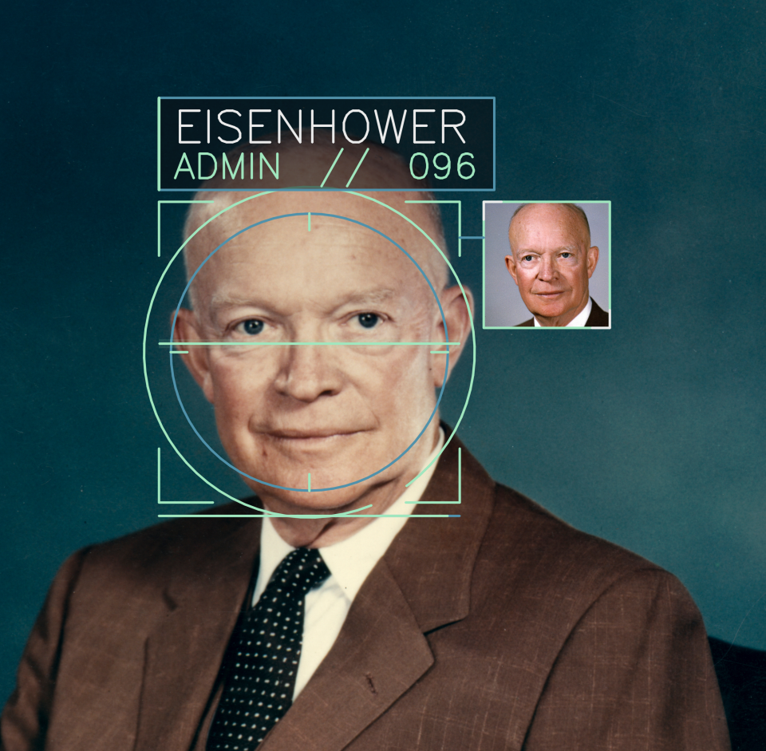

# FaceLock

Train a face **encoder**, register people in a SQLite **gallery**, run live
**camera** recognition with a Sci-Fi style HUD and access clearance
(`user` < `operator` < `admin`).



## Layout

```
├── facelock/              # Core library
│   ├── config.py           # Sizes, thresholds, default paths
│   ├── data/               # Identity-folder index, pairs, ArcFace samples
│   ├── models/             # FaceEncoder, IResNet, ArcFace, match head
│   ├── training/           # Pair-match and ArcFace loops
│   ├── gallery/            # SQLite CRUD + cosine match
│   ├── inference/          # Detect, embed, track, camera
│   └── viz/                # HUD overlays
├── assets/                 # Haar cascade + demo.png
├── data/identities/        # Your training faces (not shipped)
├── models/                 # encoder_best.pt (not shipped)
├── gallery/                # Runtime DB + reference faces
├── train.py
├── gallery_cli.py
├── camera.py
└── pyproject.toml
```

**Not included in the repo:** training images, gallery database, or trained weights.

## Install

```bash
python -m venv .venv
source .venv/bin/activate
pip install -e .
# GPU PyTorch: install the wheel that matches your driver, then pip install -e .
```

## Training data format

Place faces under `data/identities/` (or pass `--dataset-dir`):

```
data/identities/
├── alice/
│   ├── 0001.jpg
│   ├── 0002.jpg
│   └── …
├── bob/
│   ├── 0001.jpg
│   └── …
└── …
```

| Rule | Detail |
|------|--------|
| Layout | **One folder per person**; folder name = identity id |
| Images | `.jpg` / `.jpeg` / `.png`, RGB |
| Per person | At least **2 images** (needed for same-person pairs / val) |
| People | At least **2** identity folders |
| Train size | Images are resized to **112×112** |

## Train

### Pair match (default)

```bash
python train.py
python train.py --dataset-dir data/identities --epochs 20 --device cuda
```

| Setting | Default |
|---------|---------|
| Embedding | **128-D**, L2-normalized |

### ArcFace + IResNet

```bash
python train.py --method arcface --device cuda
python train.py --method arcface --backbone ir100 --epochs 40 --device cuda
```

| Setting | Default |
|---------|---------|
| `--backbone` | `ir50` (`ir18` / `ir34` / `ir50` / `ir100`) |
| Embedding | **512-D**, L2-normalized |

Best encoder: `models/checkpoints/encoder_best.pt` (also copied to
`models/encoder_best.pt`).

After changing `--method` or `--backbone`, rebuild the gallery (dims /
preprocess must match the encoder).

## Gallery

Access levels (low → high): `user` < `operator` < `admin`

```bash
python gallery_cli.py create --name Alice --access admin --image path/to/face.jpg
python gallery_cli.py list
python gallery_cli.py get --name Alice
python gallery_cli.py update --name Alice --access operator
python gallery_cli.py delete --name Alice
python gallery_cli.py check --image path/to/probe.jpg --required admin
```

`check` sets a process exit code so scripts can branch without parsing text:

| Outcome | Exit code |
|---------|-----------|
| granted | `0` |
| insufficient clearance | `2` |
| stranger | `3` |

```bash
# Only continues if access was granted
python gallery_cli.py check --image path/to/probe.jpg --required admin && unlock_door
```

## Camera

Haar detect → IoU track → gallery identify (once per track) → appearance verify
→ HUD. Press `q` to quit.

```bash
python camera.py
python camera.py --required operator --device cuda
```

| Threshold | Default | Role |
|-----------|---------|------|
| `--match-threshold` | `0.65` | Cosine to bind a gallery identity to a track |
| `--verify-threshold` | `0.50` | Cosine to keep that identity if the crop changes |
| `--confirm-hits` | `2` | Consecutive matches before binding |

## Checkpoints

| File | Produced by | Used by |
|------|-------------|---------|
| `models/encoder_best.pt` | `train.py` (`pair` or `arcface`) | `gallery_cli.py`, `camera.py` |
